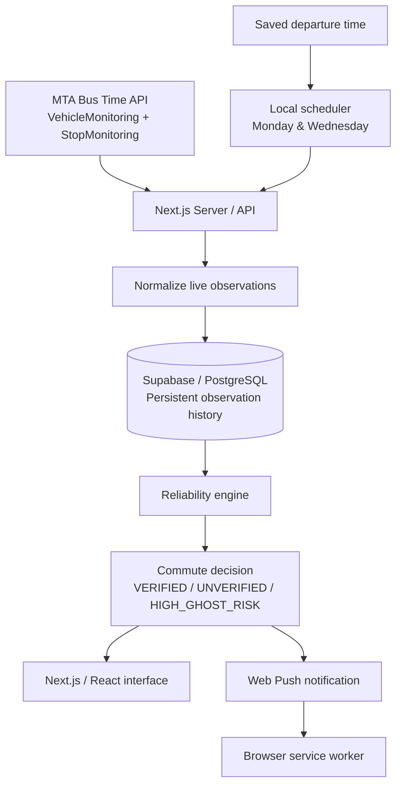
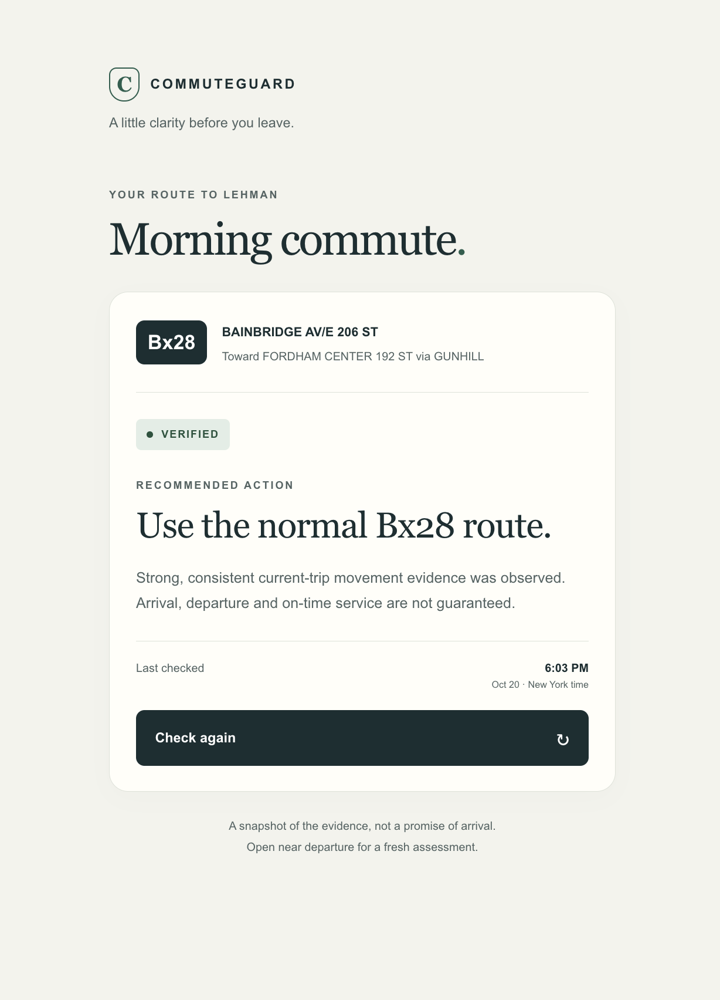
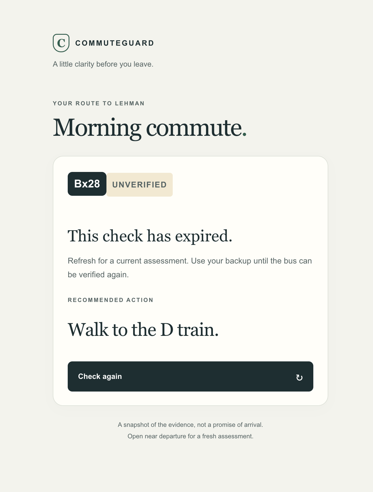

# CommuteGuard

> **Personal Commute Reliability System**  
> **Author:** Mohammed Chowdhury · **Course:** CMP 464/343 Product 1 · **Last updated:** October 25, 2026

CommuteGuard is a personal commute reliability web app for my trip to Lehman College. Before I leave home, it helps me make one decision: **should I trust my normal Bx28 commute, or should I walk to the D train instead?**

---

## 1. About Me

I am a NYC college student commuting from home to Lehman College. I rely on MTA buses, subways, and walking to reach fixed class times, lectures, quizzes, and exams. When transit information is unreliable, I lose time, energy, and sometimes money trying to decide whether to keep waiting or switch routes.

### Recent moments that motivated this project

1. One Wednesday morning, the Bx28 showed about four minutes away in a transit app, but it never arrived. I waited roughly 15 minutes before giving up and taking the D train.
2. Another time, I was worried about being late for class, so I took an Uber instead. It cost about **$20–$30**, which I did not want to spend.
3. On other mornings, I kept checking transit information and guessing whether I should wait or change routes. Even when I eventually arrived, the uncertainty wasted time and drained my energy before class.

### What this problem costs me

- **Time:** transit problems can easily waste around 15–20 minutes.
- **Money:** a last-minute Uber can cost around $20–$30.
- **Energy:** waiting, switching routes, and walking extra create unnecessary mental and physical effort.
- **Peace of mind:** I start the school day stressed before I even reach campus.

---

## 2. Problem Statement

### Gut check

> I need a way to decide whether I should trust my normal Bx28 commute or switch to my backup route before I leave home, because transit uncertainty wastes my time, stresses me out, and can make me late for class.

**Five Whys:**

1. Why?  
   Why do I leave extra time for my commute to Lehman College?

2. Why?  
   Why do I not fully trust the bus arrival time shown in transit apps?

3. Why?  
   Why do I sometimes switch routes or take an Uber at the last minute?

4. Why?  
   Why can’t I get one clear answer before I leave home about whether my normal route looks reliable?

5. Why?  
   Why do transit delays affect my classes, quizzes, and peace of mind?
   
### Full problem statement

> **When** I am getting ready to leave for Lehman College on Monday or Wednesday mornings, **I struggle to** decide whether I should trust my normal Bx28 route or switch to my backup route, **which costs me** time, money, energy, and peace of mind. **This happens because** regular transit apps show live information, but they do not give me one clear decision for my specific commute. **Right now I** manually check transit apps and try to guess, **but** one ETA is not always enough to know whether the bus is actually moving toward my stop or whether I should switch routes.

### I’ll know this is solved when...

I can check one place before leaving and quickly know whether I should **use the Bx28** or **walk to the D train**, without wasting extra time guessing.

### Current commute configuration

| Setting | Current MVP |
| --- | --- |
| Primary route | **Bx28** |
| Boarding stop | **BAINBRIDGE AV / E 206 ST** — Stop **103617** |
| Direction | **1** — FORDHAM CENTER 192 ST via GUNHILL |
| Alighting stop | **PAUL AV / BEDFORD PARK BLVD** — Stop **100080** |
| Backup route | **Walk to the D train** |
| Commute days | **Monday and Wednesday** |
| Departure time | User-selectable and saved in Supabase |
| Time zone | **America/New_York** |

---

## 3. Existing Solutions

| What I use or tried | What it does well | Why it falls short for me |
| --- | --- | --- |
| **Google Maps** | Great for directions and alternate routes. | It still leaves me to interpret the information and decide whether the Bx28 is trustworthy right now. |
| **MTA Service Alerts** | Official source for delays, reroutes, and service changes. | Alerts are often broad and do not answer whether my specific Bx28 trip is reliable enough before I leave. |
| **Transit App** | Useful live bus tracking and arrival estimates. | It shows data, but I still have to decide whether one ETA represents a bus that is actually progressing toward my stop. |

### The gap

What is still missing for me is a way to tell the bus status  before I leave home:

**Use the normal Bx28 route** or **walk to the D train**.

---

## 4. Features & Benefits

| Feature | Benefit | Status |
| --- | --- | --- |
| **Live Bx28 Commute Check** — Uses current MTA Bus Time VehicleMonitoring and StopMonitoring data. | I can check my actual commute without interpreting several transit screens myself. | **MVP** |
| **Reliability Check Using Multiple Observations** — Compares recent observations for freshness, trip assignment, and movement. | One ETA does not automatically reassure me; the recommendation is based on stronger evidence. | **MVP** |
| **Clear Status + Backup Route** — Shows `VERIFIED`, `UNVERIFIED`, or `HIGH_GHOST_RISK`, then recommends Bx28 or the D train backup. | I get one clear action instead of guessing. | **MVP** |
| **Persistent Observation History** — Stores recent observations in Supabase/PostgreSQL. | Separate checks can use the same recent evidence instead of starting from zero. | **MVP** |
| **Saved Departure Time** — Saves my selected departure time in Supabase. | I can change when CommuteGuard prepares for my commute without editing code. | **MVP** |
| **Local Scheduled Collection** — Collects observations beginning seven minutes before departure on Monday and Wednesday. | Recent evidence can already exist before the departure-time decision. | **MVP** |
| **Local Web Push** — Sends the current recommendation through a service worker at departure time. | I can receive the decision while the browser tab is in the background, as long as my Mac and local worker are running. | **MVP** |
| **Multiple Commute Profiles** | Would support additional routes, schedules, or destinations. | **Later** |
| **Commute History View** | Would show previous commute decisions and outcomes over time. | **Later** |

### Core MVP

The smallest version I would actually use contains three core behaviors:

1. **Live Bx28 commute check** using current MTA data.
2. **Reliability assessment using multiple observations**, not one ETA.
3. **One clear recommendation:** use the Bx28 or walk to the D train.

### Later

- Multiple commute profiles
- Commute decision history
- More real-world validation across additional commute days
- Hosted dynamic scheduling after a future production deployment

### Not doing

- Full NYC transit navigation
- Support for every bus and subway route
- User accounts or multiple users
- AI chatbot commute advice
- Full interactive transit map
- Native iOS or Android app

The first version is intentionally focused on one personal commute problem.

---

## 5. Tech Stack

### Front end

- **Surface:** Web
- **Tools:** Next.js, React, TypeScript
- **Why:** I wanted a mobile-friendly interface that is fast to open before leaving home.

### Back end and data

| Piece | Choice | Why |
| --- | --- | --- |
| Server / API | **Next.js Route Handlers on Node.js** | Keeps the frontend and backend in one project and handles live MTA requests and commute decisions. |
| Data storage | **Supabase / PostgreSQL** | Preserves observation history so separate requests can use the same recent evidence. |
| Transit source | **MTA Bus Time SIRI v2** — VehicleMonitoring + StopMonitoring | Provides the live bus and stop information used by the reliability engine. |
| Scheduling | **Separate local Node worker** | Reads the saved departure time and collects evidence before departure. |
| Notifications | **Web Push + service worker + VAPID** | Delivers the current recommendation locally with explicit browser permission. |
| Hosting | **Local for the current MVP** | The MVP is working locally. Production deployment is prepared but intentionally not active. |

### Architecture



### Reliability states

| State | Meaning | Recommendation |
| --- | --- | --- |
| `VERIFIED` | Enough recent and consistent evidence supports the current Bx28 trip. | Use the normal Bx28 route. |
| `UNVERIFIED` | There is not enough trustworthy current evidence. | Walk to the D train. |
| `HIGH_GHOST_RISK` | Repeated negative evidence matches CommuteGuard’s warning rules. | Walk to the D train. |

`HIGH_GHOST_RISK` is a **CommuteGuard inference**, not an official MTA status.

A central design rule is that **false reassurance is worse than an unnecessary backup warning**. If the evidence is not strong enough, CommuteGuard stays conservative.

---

## Demo

The current MVP is intentionally **local-only**. There is no public production URL.

### Demo video

[▶ Watch the CommuteGuard demo video](assets/CommuteGuard_Demo.mp4)

### Website screenshots

<table>
<tr>
<td align="center" valign="top">

<br>
<strong>Bx28 — VERIFIED</strong>
</td>
<td align="center" valign="top">

<br>
<strong>Bx28 — UNVERIFIED</strong>
</td>
</tr>
</table>

### What the demo shows

The presentation demo uses the real CommuteGuard pipeline:

1. The website is started with `pnpm dev`.
2. The demo scheduler is started with `pnpm demo:scheduler`.
3. A departure time a few minutes ahead is saved in the UI.
4. The demo performs **exactly seven real observation cycles** at about 30-second intervals.
5. Those observations are stored in the shared Supabase history.
6. CommuteGuard performs a real reliability assessment.
7. One real-status Web Push notification is attempted.
8. Pressing **Check again** performs another current assessment using the same persistent history.

The demo does **not** inject fake transit evidence, change reliability thresholds, or force a `VERIFIED` result.

---

## Testing & Validation

The transferred project was validated on **October 25, 2026** with:

```text
283 tests
283 passed
0 failed
```

The automated test suite covers:

- MTA SIRI parsing and normalization
- Bx28 route, stop, direction, and branch filtering
- reliability classification
- stale evidence and duplicate source timestamps
- Supabase/PostgreSQL persistence
- collector scheduling and authentication
- daylight-saving-time behavior
- saved departure settings
- Web Push and service-worker behavior
- demo scheduler behavior
- API behavior
- React UI states
- failure-safe behavior
- secret-handling boundaries

Run the full suite with:

```bash
pnpm test
```

Other validation commands:

```bash
pnpm typecheck
pnpm lint
pnpm build
pnpm secret:scan
```

---

## Run the Project Locally

### Requirements

- Node.js 24.x
- pnpm
- MTA Bus Time API credentials
- configured Supabase/PostgreSQL project

### Install dependencies

```bash
pnpm install
```

### Configure environment variables

Copy the safe template:

```bash
cp .env.example .env.local
```

Add the required private values to `.env.local`.

**Never commit `.env.local`, VAPID private keys, Supabase secrets, or the MTA API key.**

### Start the website

```bash
pnpm dev
```

Then open:

```text
http://localhost:3000
```

### Normal Monday/Wednesday scheduler

Run in a separate terminal:

```bash
pnpm local:scheduler
```

The Mac must remain awake and connected for local scheduled collection and push delivery.

### Presentation demo scheduler

Stop the normal local scheduler first, then run:

```bash
pnpm demo:scheduler
```

The demo mode can run on any day for presentation purposes while still using real MTA observations and the real reliability engine.

---

## Useful Commands

| Command | Purpose |
| --- | --- |
| `pnpm dev` | Start the local Next.js application |
| `pnpm test` | Run all automated tests |
| `pnpm typecheck` | Run TypeScript checks |
| `pnpm lint` | Run ESLint |
| `pnpm build` | Build the Next.js application |
| `pnpm commute:check` | Run one current commute assessment |
| `pnpm commute:observe` | Observe repeated live commute evidence |
| `pnpm history:status` | Inspect persistent observation history |
| `pnpm collector:status` | Inspect collector/backend status |
| `pnpm notification:status` | Inspect saved notification state |
| `pnpm local:scheduler` | Run the normal Monday/Wednesday scheduler |
| `pnpm demo:scheduler` | Run the presentation-friendly demo sequence |
| `pnpm secret:scan` | Scan project files for credential leakage |

---

## Current Limitations

- MTA realtime information can be stale, incomplete, conflicting, or unavailable.
- `VERIFIED` means the available evidence supports using the normal route; it is **not** a promise that the bus will arrive on time.
- `HIGH_GHOST_RISK` is a CommuteGuard inference, not an official MTA status.
- The MVP is intentionally designed around one Bx28 commute and one D-train backup.
- Normal scheduled collection and Web Push currently run locally and require an awake Mac.
- Production deployment and production Supabase Cron are **not active**.


---

## Open Questions

1. Are the current reliability thresholds the best ones, or do they need more real commute testing?
3. How reliably will local Web Push deliver on actual commute mornings?
4. What improvements would make the recommendation even easier to understand without making the product too complicated?
5. If the project is deployed later, what is the best hosted scheduling design for user-selected departure times?
